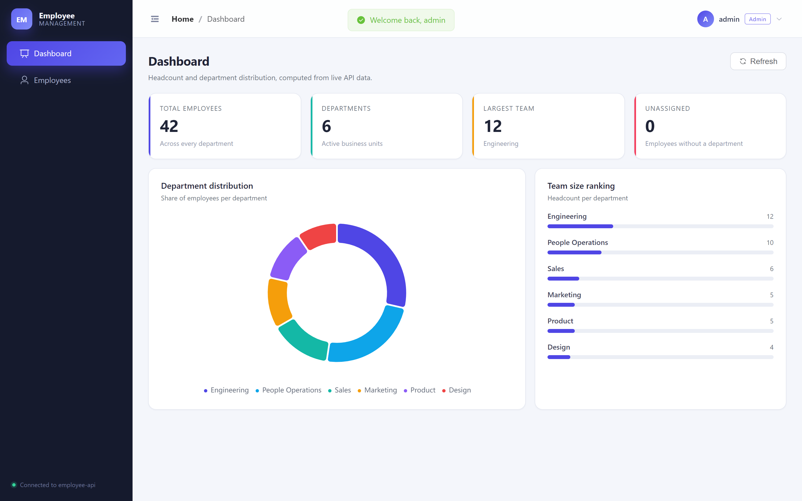
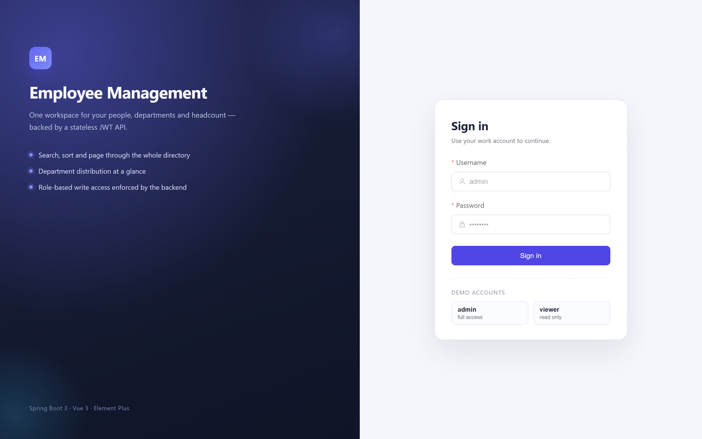
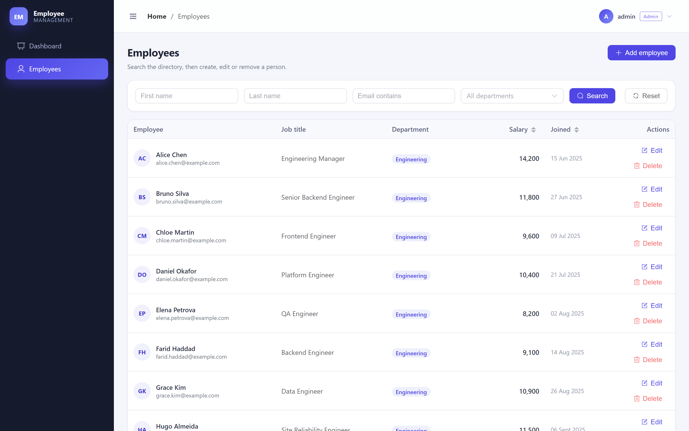
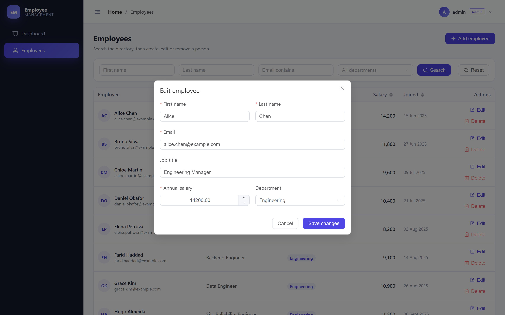
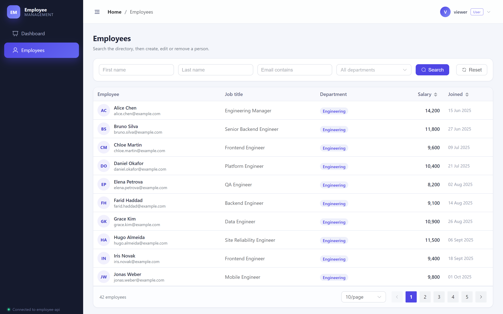
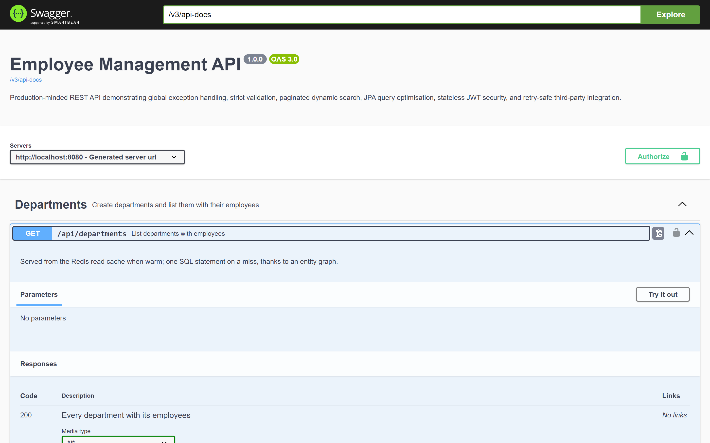
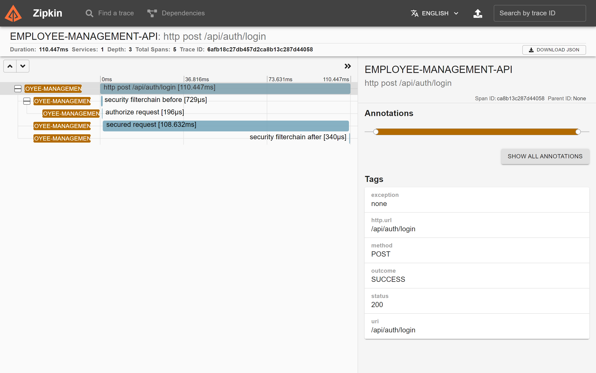
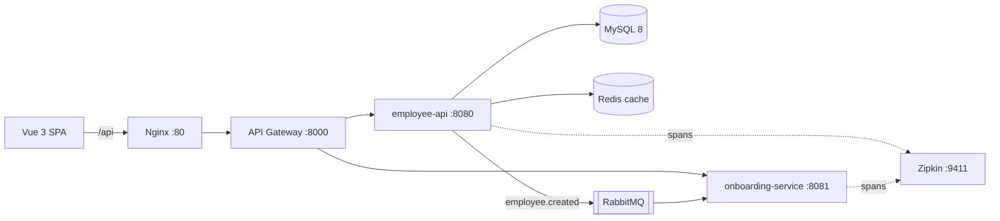

# Employee Management Platform

**Production-Ready Enterprise Employee Management System** — a Spring Boot 3 microservice backend and a Vue 3 admin console, containerised so the whole stack starts with one command.

[](https://github.com/CtrlAltDev-wq/employee-management/actions/workflows/ci.yml)
[](https://github.com/CtrlAltDev-wq/employee-management/actions/workflows/ci.yml)
[](LICENSE)
[](docker-compose.yml)




## Quick start

```bash
git clone https://github.com/CtrlAltDev-wq/employee-management.git
cd employee-management
docker compose up --build -d
```

Open **<http://localhost>** and sign in:

| Account | Password | Role |
| ------- | -------- | ---- |
| `admin` | `admin123` | full access |
| `viewer` | `viewer123` | read-only |

The first run builds four images and pulls MySQL, Redis, RabbitMQ and Zipkin. Stop everything with `docker compose down`; data survives in a named volume (`docker compose down -v` wipes it).

The database starts empty apart from two demo accounts and a demo organisation (6 departments, 42 employees), seeded only when the tables are empty. Set `DEMO_DATA_ENABLED=false` to start with nothing but the accounts.

## What you get

- **Role-based access control** — the API authorises every request (write operations require `admin`), and the SPA hides routes, menu entries and buttons for the same roles. A viewer sees a read-only directory.
- **Employee directory** — server-side pagination, filters (name, email, department, salary range), safe whitelisted sorting, and create / edit / delete with field-level validation.
- **Dashboard** — headcount, department distribution and team-size ranking computed from live API data.
- **One response contract** — every success and failure returns the same `Result<T>` envelope; `400` lists field errors while `401 / 403 / 404 / 409 / 502` keep their real meaning.
- **Caching and events** — Redis serves the read endpoints with per-cache TTLs and eviction on write; new employees are published to RabbitMQ for the onboarding service.
- **Observability** — correlation id per request, traces across HTTP and AMQP exported to Zipkin, metrics on `/actuator/prometheus`.
- **Self-documenting API** — OpenAPI 3 with Swagger UI, including a JWT "Authorize" button.

## Screenshots

| Sign in | Employee directory (admin) |
| ------- | -------------------------- |
|  |  |
| **Edit dialog** | **Read-only view (viewer)** |
|  |  |
| **OpenAPI docs** | **Distributed trace** |
|  |  |

## Architecture



| Decision | Why |
| -------- | --- |
| Split by **event**, not by entity | The consumer only needs the snapshot inside `employee.created`; no synchronous callback to the API. |
| Share the **contract**, not the code | Producer and consumer depend on a small `contracts` module, so the class name in the AMQP `__TypeId__` header always matches. |
| Authenticate **downstream** | Both services validate the same HS256 token; a gateway that is trusted blindly is not a security boundary. |
| Serve the SPA through **Nginx** | The browser stays same-origin, so no CORS is needed in production — the Vite dev proxy does the same job locally. |

## Tech stack

| Layer | Technology |
| ----- | ---------- |
| Backend | Java 17, Spring Boot 3.3.5, Spring Web, Spring Data JPA / Hibernate 6.5 |
| Security | Spring Security 6, JWT (JJWT 0.12), BCrypt |
| Data | MySQL 8 (H2 in-memory for zero-setup development) |
| Messaging | RabbitMQ 3 + Spring AMQP, publisher confirms, dead-letter queue |
| Caching | Redis 7 + Spring Cache (`@Cacheable`, `@CacheEvict`) |
| Gateway | Spring Cloud Gateway 4.1 |
| Observability | Micrometer Tracing + Zipkin, Actuator, Prometheus |
| API docs | springdoc-openapi 2.6 (Swagger UI) |
| Frontend | Vue 3.5, TypeScript, Vite 5, Pinia, Element Plus, ECharts, Axios |
| Delivery | Docker multi-stage builds, Docker Compose, Nginx |
| Testing | JUnit 5, Mockito, MockMvc, AssertJ |

## API at a glance

| Method | Endpoint | Access |
| ------ | -------- | ------ |
| `POST` | `/api/auth/login` | public |
| `GET` | `/api/employees` | authenticated |
| `GET` | `/api/employees/{id}` | authenticated |
| `POST` | `/api/employees` | `admin` |
| `PUT` | `/api/employees/{id}` | `admin` |
| `DELETE` | `/api/employees/{id}` | `admin` |
| `GET` | `/api/departments` | authenticated |

Swagger UI: <http://localhost:8080/swagger-ui.html> · Gateway: <http://localhost:8000> · Zipkin: <http://localhost:9411>

## Run without Docker

```bash
# backend — H2 in memory, no external services required
mvn spring-boot:run -pl employee-management-api

# backend — against your own MySQL instead
SPRING_PROFILES_ACTIVE=mysql mvn spring-boot:run -pl employee-management-api

# web — proxies /api to localhost:8080
cd employee-management-web && npm install && npm run dev
```

Environment overrides: `MYSQL_HOST`, `MYSQL_PORT`, `MYSQL_DATABASE`, `MYSQL_USERNAME`, `MYSQL_PASSWORD`, `JWT_SECRET`, `CACHE_PROVIDER` (`redis` / `simple`), `MESSAGING_ENABLED` (`true` / `false`).

### Hybrid: containers for middleware, IDE for the API

Middleware in containers, business code in your debugger. Leave the API container out of the stack so it cannot fight your IDE for port 8080, and point the gateway at the host:

```bash
docker compose up -d --no-deps mysql redis rabbitmq zipkin

# in the IDE: SPRING_PROFILES_ACTIVE=mysql and
# MYSQL_HOST=127.0.0.1, REDIS_HOST=127.0.0.1, RABBITMQ_HOST=127.0.0.1 (password "wangqi")
EMPLOYEE_API_URI=http://host.docker.internal:8080 \
  docker compose up -d --no-deps api-gateway web onboarding-service
```

`--no-deps` and the explicit service list are the point: a plain `docker compose up -d` also starts `employee-api`, whose published port then collides with your IDE. `http://localhost` keeps working and its `/api` calls reach the debugging session.

MySQL, Redis, RabbitMQ and Zipkin publish their ports, so a GUI client connects to `127.0.0.1:3306`, `:6379` and `:15672` while the API runs outside Docker. `ONBOARDING_SERVICE_URI` works the same way for the consumer.

Back to everything in containers: stop the IDE, then `docker compose up -d` — gateway defaults to the service name again.

## Tests

```bash
mvn test                  # 82 tests: contracts, API, onboarding service, gateway
cd employee-management-web && npm run build   # type-check + production bundle
```

Each engineering claim is backed by a test that fails if the behaviour regresses — the N+1 fix (4 SQL statements → 1), cache hits (zero SQL on a second read), idempotent replays, and the RBAC boundary.

## Project layout

```text
.
├── contracts/                 shared event DTOs
├── employee-management-api/   employees, departments, auth, cache, Swagger
├── onboarding-service/        consumer of employee.created
├── api-gateway/               public entry point
├── employee-management-web/   Vue 3 admin console + Nginx image
├── docs/                      screenshots and the architecture deep dive
└── docker-compose.yml         8 containers, one command
```

---

Deeper notes on the N+1 fix, cache invalidation, idempotency, tracing and the service split live in [docs/ARCHITECTURE.md](docs/ARCHITECTURE.md).

Author: **wangqi**

## License

MIT — see [LICENSE](LICENSE).
